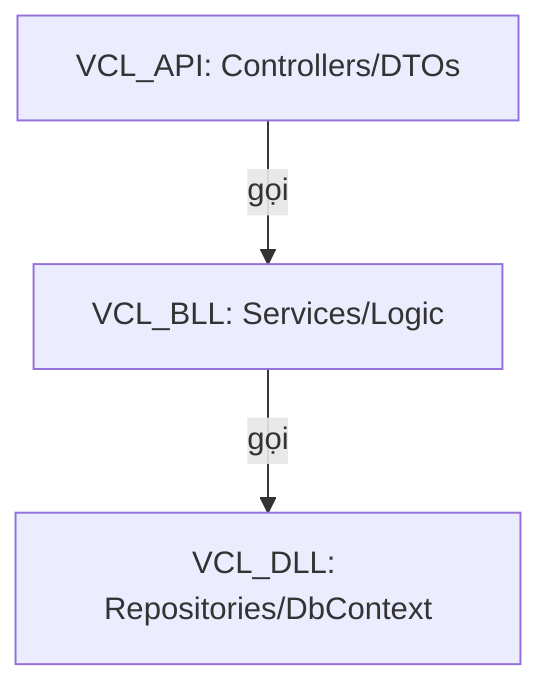

# VCL Coding Guide (Hướng Dẫn Quy Chuẩn Code)

Tài liệu này hướng dẫn các tiêu chuẩn viết code, tổ chức thư mục và quy trình phát triển cho hệ thống **Vietnam Cross-Border Logistics System (VCL)**. Tất cả thành viên trong nhóm phát triển và AI agent cần tuân thủ nghiêm ngặt các quy tắc này.

---

## 1. Tổ Chức Kiến Trúc Phân Lớp (Layered Architecture)

Dự án tuân theo kiến trúc 3 lớp chuẩn nhằm tách biệt rõ ràng các nhiệm vụ (Separation of Concerns):



### 1.1. VCL_API (Lớp Giao Tiếp / HTTP)
*   **Nhiệm vụ**: Tiếp nhận HTTP Request, validate dữ liệu đầu vào cơ bản (Data Annotations), gọi lớp BLL xử lý và trả về kết quả HTTP phù hợp (200 OK, 400 BadRequest, 404 NotFound, 500 Error).
*   **Quy tắc**:
    *   **Controllers phải cực kỳ mỏng (Thin Controllers)**: Không chứa logic tính toán thuế phí, không truy vấn database trực tiếp.
    *   Chỉ nhận và trả về các lớp **DTO (Data Transfer Object)**, tuyệt đối không trả về trực tiếp Database Entities.

### 1.2. VCL_BLL (Lớp Nghiệp Vụ - Business Logic Layer)
*   **Nhiệm vụ**: Thực hiện toàn bộ logic nghiệp vụ (ví dụ: tính toán thuế hải quan `CustomsTaxis`, phân tích tải trọng `Parcel` để gom vào `MasterBox`, kiểm tra danh sách cấm `RestrictedItem`).
*   **Quy tắc**:
    *   Không được tham chiếu tới `Microsoft.AspNetCore.Http` hay các kiểu dữ liệu liên quan đến Web/Controller.
    *   Ném ra các Custom Exceptions (ví dụ: `AuthException`, `LogisticsException`) khi có lỗi nghiệp vụ để Middleware ở API tự động bắt và format thành JSON response.

### 1.3. VCL_DLL (Lớp Dữ Liệu - Data Access/Link Layer)
*   **Nhiệm vụ**: Định nghĩa cấu trúc Database (EF Core Models), quản lý DbContext và thực thi các câu lệnh truy vấn xuống DB (Repositories).
*   **Quy tắc**:
    *   Tuyệt đối không xử lý nghiệp vụ logistics ở đây.
    *   Không hardcode connection string trong code.

---

## 2. Quy Tắc Đặt Tên (Naming Conventions)

Tuân thủ quy tắc đặt tên tiêu chuẩn của C# / .NET:

| Đối tượng | Quy tắc đặt tên | Ví dụ |
| :--- | :--- | :--- |
| **Class / Struct / Enum** | `PascalCase` | `CustomsDeclaration`, `WarehouseZone` |
| **Interface** | `IPascalCase` (Bắt đầu bằng chữ `I`) | `IOrderService`, `IUserRepository` |
| **Method (Hàm)** | `PascalCase` | `CalculateShippingFee()`, `VerifyOtp()` |
| **Properties** | `PascalCase` | `ResetPasswordOtpHash`, `Weight` |
| **Local variable (Biến cục bộ)** | `camelCase` | `failedAttempts`, `currentUser` |
| **Method Parameters (Tham số)** | `camelCase` | `email`, `newPassword` |
| **Private Field (Biến private)** | `_camelCase` (Bắt đầu bằng gạch dưới) | `_dbContext`, `_emailService` |

---

## 3. Quản Lý Entity Framework Core & Migrations

Khi cần thay đổi cấu trúc bảng hoặc thêm bảng mới, thực hiện theo các bước sau:

1.  **Build kiểm tra lỗi biên dịch**:
    ```bash
    dotnet build VCL_BLL/VCL_BLL.csproj
    ```
2.  **Tạo migration mới** (Sử dụng tên mô tả rõ ràng hành động, viết kiểu `CamelCase`):
    ```bash
    dotnet ef migrations add <MigrationName> --project VCL_DLL --startup-project VCL_API
    ```
3.  **Cập nhật database**:
    ```bash
    dotnet ef database update --project VCL_DLL --startup-project VCL_API
    ```

---

## 4. Quy Tắc Bảo Mật & Thông Tin Nhạy Cảm (Secrets)

> [!CAUTION]
> **Không bao giờ commit Connection String chứa mật khẩu hoặc Private Key lên Git!**

*   **Môi trường Development**: Dùng biến môi trường đặt trong file `.env` (đã được đưa vào `.gitignore`) hoặc sử dụng tính năng **User Secrets** của .NET:
    ```bash
    dotnet user-secrets set "ConnectionStrings:DefaultConnection" "Server=..." --project VCL_API
    ```
*   **Môi trường Production**: Đọc trực tiếp từ Environment Variables của Docker Container / Cloud Service.

---

## 5. Đồng Bộ Tài Liệu API

Khi viết mới hoặc thay đổi bất kỳ Endpoint nào:
1.  Cập nhật mã nguồn C# Controller & DTOs.
2.  Cập nhật tài liệu kỹ thuật tích hợp tại [API_INTEGRATION.md](file:///c:/DO_AN/vcl-BE/docs/API_INTEGRATION.md). Đảm bảo định nghĩa kiểu TypeScript ở tài liệu trùng khớp 100% với DTO của C#.
