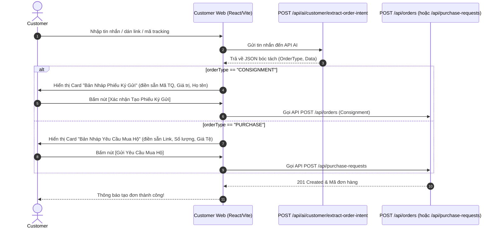

# API CONTRACT: AI AGENT HỖ TRỢ TẠO ĐƠN KÝ GỬI & MUA HỘ (FOR FRONT-END)

Tài liệu này hướng dẫn đội ngũ Front-End (Customer Web / Mobile App) tích hợp API AI Agent tự động phân tích câu văn, tin nhắn của Khách hàng để bóc tách dữ liệu thành bản nháp **Đơn Ký Gửi (CONSIGNMENT)** hoặc **Đơn Mua Hộ (PURCHASE)**.

---

## 📌 1. Tổng quan Endpoint

* **HTTP Method:** `POST`
* **Endpoint URL:** `/api/ai/customer/extract-order-intent`
* **Authentication:** Yêu cầu Header `Authorization: Bearer <JWT_TOKEN>`
* **Content-Type:** `application/json`

---

## 📥 2. Request Payload (Đầu vào từ FE)

### Cấu trúc Request Object

| Trường | Kiểu dữ liệu | Bắt buộc | Mô tả |
| :--- | :---: | :---: | :--- |
| `message` | `string` | **Có** | Nội dung tin nhắn tự nhiên từ khách hàng (Ví dụ: câu thoại, link sản phẩm, mã tracking TQ...) |
| `customerId` | `string` (Guid) | Không | ID khách hàng (nếu đã đăng nhập, giúp AI điền sẵn họ tên, SĐT) |
| `preferredShippingRoute` | `string` | Không | Route ưu tiên nếu khách chọn trước: `"CN-VN-ROAD"` hoặc `"CN-VN-AIR"` |

### JSON Request mẫu

```json
{
  "message": "Order giúp mình 3 cái bàn phím cơ link https://detail.tmall.com/item.htm?id=9999 giá 200 Tệ màu Đen ship về HCM cho Nam 0901234567",
  "customerId": "3fa85f64-5717-4562-b3fc-2c963f66afa6",
  "preferredShippingRoute": "CN-VN-ROAD"
}
```

---

## 📤 3. Response Payload (Kết quả AI bóc tách trả về FE)

### Cấu trúc Response Object

| Trường | Kiểu dữ liệu | Mô tả |
| :--- | :---: | :--- |
| `message` | `string` | Thông báo thành công |
| `data.orderType` | `string` | **`"CONSIGNMENT"`** (Ký gửi) hoặc **`"PURCHASE"`** (Mua hộ) |
| `data.confidenceScore` | `number` | Độ tin cậy của AI (0.0 đến 1.0) |
| `data.explanation` | `string` | Giải thích ngắn bằng tiếng Việt về lý do AI nhận diện |
| `data.productName` | `string` | Tên sản phẩm chính trích xuất được |
| **--- Thông tin Ký gửi ---** | | *(Chỉ có khi `orderType == "CONSIGNMENT"`)* |
| `data.chinaTrackingCode` | `string` | Mã vận đơn nội địa TQ (SF..., YT..., 78...) |
| `data.declaredValueCny` | `number` | Giá trị khai báo kiện hàng (Tệ - CNY) |
| `data.shippingRoute` | `string` | Phương thức: `"CN-VN-ROAD"` (Đường bộ) hoặc `"CN-VN-AIR"` (Hàng không) |
| `data.destinationWarehouse` | `string` | Kho đích tại Việt Nam (VD: Kho Hà Nội, Kho HCM) |
| **--- Thông tin Mua hộ ---** | | *(Chỉ có khi `orderType == "PURCHASE"`)* |
| `data.productLink` | `string` | Link sản phẩm Taobao/1688/Tmall |
| `data.variant` | `string` | Phân loại hàng (Màu sắc, kích thước, size) |
| `data.quantity` | `number` | Số lượng mua |
| `data.unitPriceCny` | `number` | Đơn giá Nhân dân tệ (CNY) |
| **--- Thông tin Người nhận ---** | | |
| `data.receiverName` | `string` | Họ tên người nhận tại Việt Nam |
| `data.receiverPhone` | `string` | Số điện thoại người nhận |
| `data.receiverAddress` | `string` | Địa chỉ giao hàng tại Việt Nam |
| `data.note` | `string` | Ghi chú thêm |
| `data.warnings` | `array[string]` | Các cảnh báo hệ thống (nếu có) |

---

## 🧪 4. Ví dụ chi tiết cho 2 trường hợp

### Trường hợp 1: Khách hàng muốn KÝ GỬI HÀNG (CONSIGNMENT)

#### Request:
```json
{
  "message": "Mình có kiện hàng mỹ phẩm mã tracking TQ là YT789654321, giá trị 500 Tệ, ship về kho Hà Nội bằng đường bộ cho người nhận Trần Văn A - 0987654321"
}
```

#### Response Success (`200 OK`):
```json
{
  "message": "Trích xuất thông tin tạo đơn bằng AI thành công.",
  "data": {
    "orderType": "CONSIGNMENT",
    "confidenceScore": 0.95,
    "explanation": "AI nhận diện khách hàng muốn tạo đơn Ký gửi với mã vận đơn TQ YT789654321...",
    "chinaTrackingCode": "YT789654321",
    "declaredValueCny": 500,
    "shippingRoute": "CN-VN-ROAD",
    "destinationWarehouse": "Kho Hà Nội",
    "productLink": null,
    "variant": null,
    "quantity": 1,
    "unitPriceCny": null,
    "productName": "Mỹ phẩm",
    "category": "Cosmetics",
    "receiverName": "Trần Văn A",
    "receiverPhone": "0987654321",
    "receiverAddress": null,
    "note": null,
    "extractedItems": [],
    "warnings": []
  }
}
```

---

### Trường hợp 2: Khách hàng muốn MUA HỘ (PURCHASE)

#### Request:
```json
{
  "message": "Order giúp mình 3 cái tai nghe link https://detail.tmall.com/item.htm?id=9999 giá 200 Tệ màu Đen ship về 123 Nguyễn Trãi, Hà Nội cho Nam 0901234567"
}
```

#### Response Success (`200 OK`):
```json
{
  "message": "Trích xuất thông tin tạo đơn bằng AI thành công.",
  "data": {
    "orderType": "PURCHASE",
    "confidenceScore": 0.95,
    "explanation": "AI phát hiện yêu cầu Mua hộ qua link sản phẩm Tmall với số lượng 3 và đơn giá 200 Tệ.",
    "chinaTrackingCode": null,
    "declaredValueCny": null,
    "shippingRoute": "CN-VN-ROAD",
    "destinationWarehouse": null,
    "productLink": "https://detail.tmall.com/item.htm?id=9999",
    "variant": "Màu Đen",
    "quantity": 3,
    "unitPriceCny": 200,
    "productName": "Tai nghe",
    "category": "Electronics",
    "receiverName": "Nam",
    "receiverPhone": "0901234567",
    "receiverAddress": "123 Nguyễn Trãi, Hà Nội",
    "note": null,
    "extractedItems": [],
    "warnings": []
  }
}
```

---

## 🎨 5. Hướng dẫn Luồng hiển thị UI/UX cho Front-End (Recommended Flow)



### 💡 Lưu ý quan trọng cho FE:
1. **Kiểm tra `data.orderType`**:
   * Nếu là `"CONSIGNMENT"` -> Mở Modal/Form Ký gửi và điền các trường `chinaTrackingCode`, `declaredValueCny`.
   * Nếu là `"PURCHASE"` -> Mở Modal/Form Mua hộ và điền các trường `productLink`, `quantity`, `unitPriceCny`, `variant`.
2. **Không tự động submit**: Sau khi AI bóc tách xong, FE hãy hiển thị các ô input đã được điền sẵn để người dùng **kiểm tra lại và bấm nút xác nhận**.
3. **Hiển thị `data.explanation`**: Có thể hiển thị dòng giải thích nhỏ của AI (VD: *"AI đã hỗ trợ tự động bóc tách thông tin từ tin nhắn của bạn..."*) để tăng trải nghiệm người dùng.
