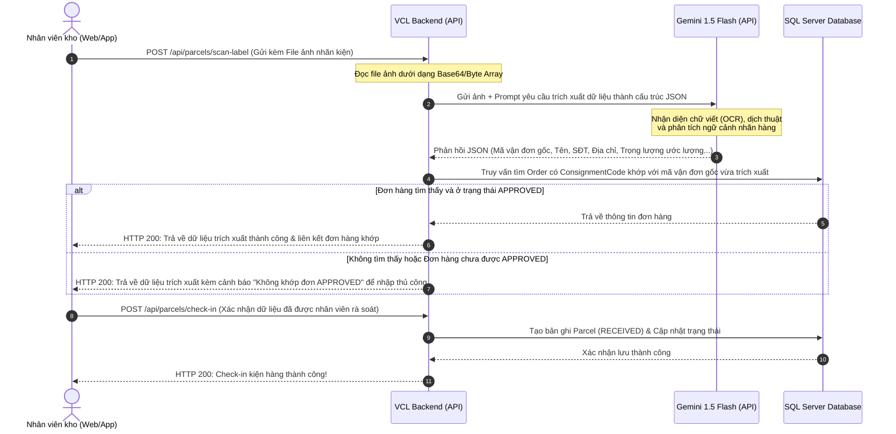

# Thiết kế chi tiết Tính năng AI Smart Check-in (OCR & LLM Package Parser)

Tài liệu này mô tả thiết kế chi tiết cho việc tích hợp AI vào phân hệ Quản lý kho (WMS) của hệ thống VCL, phục vụ cho việc nhập kho tự động (Check-in) thông qua việc nhận diện hình ảnh nhãn kiện hàng (Shipping Label).

---

## 1. Giới thiệu & Mục tiêu (Overview)
Trong hoạt động Logistics Việt - Trung, nhân viên kho tại Trung Quốc hoặc Việt Nam thường phải xử lý hàng nghìn kiện hàng ký gửi mỗi ngày. Nhãn dán trên các kiện hàng thường là tiếng Trung (vận đơn nội địa Trung Quốc như Taobao, 1688, J&T China...) hoặc tiếng Anh.
*   **Vấn đề**: Việc gõ tay mã vận đơn và thông tin khách hàng rất chậm và dễ nhầm lẫn.
*   **Giải pháp**: Tích hợp AI OCR + LLM. Nhân viên kho chỉ cần chụp ảnh nhãn kiện hàng gửi lên hệ thống. AI sẽ tự động phân tích chữ viết trên nhãn, dịch sang tiếng Việt (nếu cần), trích xuất mã vận đơn gốc, thông tin người nhận, và tự động đối chiếu với các đơn hàng `APPROVED` trên hệ thống để điền nhanh thông tin check-in.
*   **Công nghệ**:
    *   **Backend**: C# ASP.NET Core Web API.
    *   **AI Service**: Gemini 1.5 Flash API (sử dụng khả năng đa phương thức - Multimodal để nhận diện văn bản từ hình ảnh và phân tích ngữ cảnh trực tiếp thông qua Prompt Engineering, trả về cấu trúc JSON).

---

## 2. Luồng đi của dữ liệu (Data Flow Diagram)

Dưới đây là sơ đồ tuần tự thể hiện sự tương tác giữa **Frontend (Web/Mobile)**, **VCL Backend**, và **Gemini AI Service**:



---

## 3. Chi tiết API Specs (Cấu trúc API mới)

Hệ thống sẽ bổ sung thêm một Endpoint mới trong [ParcelController](file:///c:/DO_AN/vcl-BE/VietnamCrossBorderLogictisSystem/VCL_API/Controllers/ParcelController.cs):

### API 1: Quét và phân tích nhãn kiện hàng bằng AI
*   **Endpoint**: `POST /api/parcels/scan-label`
*   **Mô tả**: Nhân viên kho tải lên ảnh chụp nhãn kiện hàng để AI nhận diện và trích xuất dữ liệu.
*   **Quyền truy cập (Authorize)**: `WarehouseStaff`, `Staff`
*   **Định dạng request (Content-Type)**: `multipart/form-data`

#### Request Body:
| Trường | Kiểu dữ liệu | Bắt buộc | Mô tả |
| :--- | :--- | :--- | :--- |
| `labelImage` | File (IFormFile) | Có | Ảnh chụp nhãn kiện hàng rõ nét |

#### Response (HTTP 200 OK) - JSON Structure:
```json
{
  "message": "Phân tích nhãn kiện hàng thành công.",
  "data": {
    "shippingCode": "VCL-20260709-12345",
    "isMatchedOrder": true,
    "matchedOrderId": "38a1194c-a725-4f12-9901-cb9dab7023c4",
    "customerName": "Nguyễn Văn A",
    "customerPhone": "0987654321",
    "estimatedWeight": 3.5,
    "dimensions": {
      "length": 30,
      "width": 20,
      "height": 10
    },
    "rawTextExtracted": "VCL-20260709-12345 | Receiver: Nguyen Van A | Weight: 3.5kg | Size: 30x20x10cm",
    "confidenceScore": "HIGH"
  }
}
```

#### Các mã lỗi có thể trả về:
*   `400 Bad Request`: Ảnh không hợp lệ hoặc không có dữ liệu hình ảnh.
*   `401 Unauthorized`: Người dùng chưa đăng nhập.
*   `403 Forbidden`: Người dùng không có quyền (yêu cầu role `WarehouseStaff`).
*   `500 Internal Server Error`: Lỗi kết nối tới Gemini API hoặc phân tích dữ liệu thất bại.

---

## 4. Đặc tả Prompt cho Gemini API (AI System Prompt)
Để Gemini trả về dữ liệu chuẩn JSON không bị lẫn tạp chất, Backend C# sẽ gửi một System Prompt như sau:

> **System Prompt**:
> Bạn là một trợ lý AI chuyên nghiệp cho hệ thống Logistics xuyên biên giới Việt - Trung.
> Nhiệm vụ của bạn là phân tích hình ảnh nhãn kiện hàng (Shipping Label) được cung cấp, thực hiện nhận diện văn bản (OCR) và dịch các thông tin tiếng Trung/Anh sang tiếng Việt.
> Hãy trích xuất và trả về dữ liệu dưới dạng **chỉ gồm duy nhất định dạng JSON** như cấu trúc mẫu sau (không chứa thẻ markdown ` ```json ` hay giải thích thêm):
> {
>   "shippingCode": "Trích xuất mã vận đơn bắt đầu bằng VCL- nếu có, nếu không thì lấy mã vận đơn nội địa Trung Quốc",
>   "customerName": "Tên người nhận",
>   "customerPhone": "Số điện thoại người nhận",
>   "estimatedWeight": "Trọng lượng ghi trên nhãn (số thập phân, đơn vị kg), nếu không có trả về null",
>   "length": "Chiều dài ghi trên nhãn (cm), nếu không có trả về null",
>   "width": "Chiều rộng ghi trên nhãn (cm), nếu không có trả về null",
>   "height": "Chiều cao ghi trên nhãn (cm), nếu không có trả về null",
>   "rawTextExtracted": "Tất cả các dòng chữ thô đọc được trên nhãn dán"
> }

---

## 5. Lợi ích khoa học và thực tiễn đối với Đồ án Tốt nghiệp
1.  **Tính khoa học**: Minh chứng khả năng làm chủ công nghệ trí tuệ nhân tạo (Generative AI) tích hợp đa phương thức (Multimodal LLM) thay thế cho các giải pháp OCR truyền thống (vốn hoạt động kém hiệu quả khi gặp nhãn dán bị nhăn, nghiêng góc hoặc nhiều ngôn ngữ phức tạp).
2.  **Tính thực tiễn**: Tăng tốc độ nhập kho lên gấp **5 - 10 lần**, loại bỏ hoàn toàn việc gõ tay lỗi chính tả số điện thoại và mã vận đơn của nhân viên kho, giảm thiểu rủi ro thất lạc đơn hàng trong quá trình vận chuyển xuyên biên giới.
