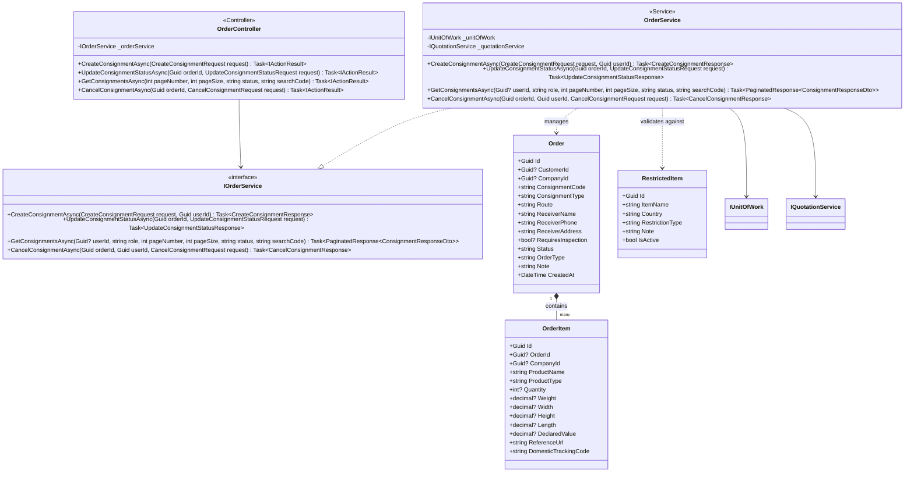
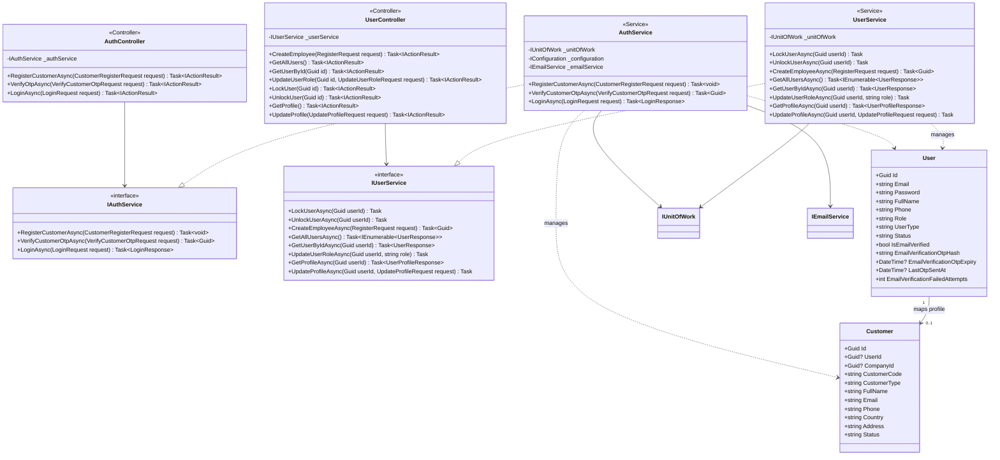

# 3. Detailed Design

Tài liệu thiết kế chi tiết (Detailed Design) cho hệ thống **Vietnam Cross-Border Logistics System (VCL)**. Tài liệu mô tả kiến trúc chi tiết, sơ đồ lớp (Class Diagram) và sơ đồ tuần tự (Sequence Diagram) cho các phân hệ cốt lõi của hệ thống backend sử dụng .NET 8.

---

## 3.1 Warehouse Management (WMS) Architecture Overview

Phân hệ quản lý kho hàng (Warehouse Management System - WMS) được thiết kế theo kiến trúc 3 lớp (Presentation, Business Logic, và Data Access) kết hợp với mẫu thiết kế **Repository** và **Unit of Work** nhằm đảm bảo tính toàn vẹn dữ liệu, hiệu năng cao và phân tách rõ ràng các trách nhiệm (Separation of Concerns).

Toàn bộ yêu cầu xử lý từ giao diện người dùng (hoặc thiết bị PDA cầm tay của nhân viên kho) được gửi qua các Controllers (Presentation), chuyển tiếp tới lớp Services (Business Logic) để thực hiện tính toán thể tích/tải trọng khả dụng, và cuối cùng truy xuất cơ sở dữ liệu thông qua Generic Repository và Unit of Work (Data Access).

---

### 3.1.1 Class Diagram

Sơ đồ lớp dưới đây thể hiện cấu trúc phân lớp của phân hệ WMS, bao gồm các Controller (`ParcelController`, `BinController`, `ShipmentController`), các Service tương ứng xử lý nghiệp vụ, `IUnitOfWork` quản lý transaction, và các Entity/Model đại diện cho bảng dữ liệu.

```mermaid
classDiagram
    direction TB

    %% Presentation Layer
    class ParcelController {
        <<Controller>>
        -IParcelService _parcelService
        +CheckInParcelAsync(ParcelCheckInRequest request) Task~IActionResult~
        +GetPendingPutawayParcelsAsync(int pageNumber, int pageSize, string search, string status) Task~IActionResult~
        +PutAwayParcelAsync(Guid parcelId, ParcelPutAwayRequest request) Task~IActionResult~
    }

    class BinController {
        <<Controller>>
        -IBinService _binService
        +GetBinsByWarehouseAsync(Guid warehouseId) Task~IActionResult~
        +GetBinCapacityAsync(Guid binId) Task~IActionResult~
    }

    class ShipmentController {
        <<Controller>>
        -IShipmentService _shipmentService
        +ConsolidateParcelsAsync(ConsolidateParcelsRequest request) Task~IActionResult~
        +CreateShipmentAsync(CreateShipmentRequest request) Task~IActionResult~
        +UpdateShipmentStatusAsync(Guid shipmentId, string status) Task~IActionResult~
    }

    %% Business Logic Layer
    class IParcelService {
        <<interface>>
        +CheckInParcelAsync(ParcelCheckInRequest request) Task~ParcelCheckInResponse~
        +GetParcelDetailAsync(Guid parcelId) Task~ParcelDetailResponse~
        +GetPendingPutawayParcelsAsync(int pageNo, int pageSize, string search, string status) Task~PaginatedResponse~PendingPutawayParcelDto~~
        +PutAwayParcelAsync(Guid parcelId, ParcelPutAwayRequest request) Task~ParcelPutAwayResponse~
    }

    class ParcelService {
        <<Service>>
        -IUnitOfWork _unitOfWork
        +CheckInParcelAsync(ParcelCheckInRequest request) Task~ParcelCheckInResponse~
        +GetParcelDetailAsync(Guid parcelId) Task~ParcelDetailResponse~
        +GetPendingPutawayParcelsAsync(int pageNo, int pageSize, string search, string status) Task~PaginatedResponse~PendingPutawayParcelDto~~
        +PutAwayParcelAsync(Guid parcelId, ParcelPutAwayRequest request) Task~ParcelPutAwayResponse~
    }

    class IBinService {
        <<interface>>
        +GetBinsByWarehouseAsync(Guid warehouseId) Task~IEnumerable~BinDto~~
        +CheckBinCapacityAsync(Guid binId, decimal volume, decimal weight) Task~bool~
    }

    class BinService {
        <<Service>>
        -IUnitOfWork _unitOfWork
        +GetBinsByWarehouseAsync(Guid warehouseId) Task~IEnumerable~BinDto~~
        +CheckBinCapacityAsync(Guid binId, decimal volume, decimal weight) Task~bool~
    }

    class IShipmentService {
        <<interface>>
        +ConsolidateParcelsAsync(ConsolidateParcelsRequest request) Task~MasterBoxDto~
        +CreateShipmentAsync(CreateShipmentRequest request) Task~ShipmentDto~
        +UpdateShipmentStatusAsync(Guid shipmentId, string status) Task~bool~
    }

    class ShipmentService {
        <<Service>>
        -IUnitOfWork _unitOfWork
        +ConsolidateParcelsAsync(ConsolidateParcelsRequest request) Task~MasterBoxDto~
        +CreateShipmentAsync(CreateShipmentRequest request) Task~ShipmentDto~
        +UpdateShipmentStatusAsync(Guid shipmentId, string status) Task~bool~
    }

    %% Data Access Layer (Repositories & Unit of Work)
    class IUnitOfWork {
        <<interface>>
        +Repository~T~() IGenericRepository~T~
        +SaveChangesAsync() Task~int~
    }

    class UnitOfWork {
        <<UnitOfWork>>
        -DbContext _context
        -Dictionary~Type, object~ _repositories
        +Repository~T~() IGenericRepository~T~
        +SaveChangesAsync() Task~int~
    }

    class IGenericRepository~T~ {
        <<interface>>
        +GetAllAsync() Task~IEnumerable~T~~
        +GetByIdAsync(object id) Task~T?~
        +AddAsync(T entity) Task
        +Update(T entity) void
        +Delete(T entity) void
    }

    %% Entity Models
    class Parcel {
        +Guid Id
        +Guid? ConsignmentId
        +Guid? MasterBoxId
        +string PackageCode
        +decimal? ActualWeight
        +decimal? VolumetricWeight
        +decimal? ChargeableWeight
        +decimal? Width
        +decimal? Height
        +decimal? Length
        +string PackageStatus
        +DateTime? CheckInTime
        +DateTime? PutAwayTime
        +Guid? BinId
    }

    class Bin {
        +Guid Id
        +Guid? ProductId
        +Guid? WarehouseId
        +Guid? ShelfId
        +string BinCode
        +decimal? MaxVolume
        +decimal? CurrentVolume
        +decimal? MaxWeight
    }

    class MasterBox {
        +Guid Id
        +Guid? ShipmentId
        +string MasterCode
        +decimal? TotalWeight
        +decimal? TotalVolume
        +string Status
    }

    class Shipment {
        +Guid Id
        +Guid? ConsignmentId
        +Guid? OriginWarehouseId
        +Guid? DestinationWarehouseId
        +Guid? CarrierId
        +Guid? MasterBoxId
        +string ShipmentType
        +string ShipmentStage
        +string Status
        +string ShipmentCode
    }

    %% Layer Dependencies
    ParcelController --> IParcelService
    BinController --> IBinService
    ShipmentController --> IShipmentService

    ParcelService ..|> IParcelService
    BinService ..|> IBinService
    ShipmentService ..|> IShipmentService

    ParcelService --> IUnitOfWork
    BinService --> IUnitOfWork
    ShipmentService --> IUnitOfWork

    UnitOfWork ..|> IUnitOfWork
    UnitOfWork --> IGenericRepository

    %% Entities mapping
    Parcel "many" --> "1" Bin : stored in
    Parcel "many" --> "0..1" MasterBox : grouped in
    MasterBox "many" --> "0..1" Shipment : loaded on
    Bin "many" --> "1" Warehouse : belongs to
    Shipment "many" --> "1" Warehouse : origin/destination

    ParcelService ..> Parcel : manages
    BinService ..> Bin : manages
    ShipmentService ..> Shipment : manages
    ShipmentService ..> MasterBox : manages
```



---

### 3.1.2 Sequence Diagram: Receiving Parcels into Origin Warehouse

Quy trình tiếp nhận kiện hàng thực tế tại kho nguồn (Inbound Check-in). Nhân viên kho (Warehouse Staff) quét mã gửi hàng (Consignment Code) để phê duyệt và khởi tạo kiện hàng trong hệ thống.

```mermaid
sequenceDiagram
    autonumber
    actor Staff as Warehouse Staff
    participant UI as &laquo;User Interface&raquo;<br/>:Warehouse App
    participant PC as &laquo;Controller&raquo;<br/>:ParcelController
    participant PS as &laquo;Service&raquo;<br/>:ParcelService
    participant UOW as &laquo;UnitOfWork&raquo;<br/>:IUnitOfWork
    participant Repo as &laquo;Repository&raquo;<br/>:IGenericRepository
    participant DB as &laquo;Database&raquo;<br/>:SQL Server

    Staff ->> UI: Scan consignment code / enter dimensions
    activate UI
    UI ->> PC: POST /api/parcels/check-in (ShippingCode, ActualWeight, dimensions)
    activate PC
    PC ->> PS: CheckInParcelAsync(request)
    activate PS

    Note over PS: Validate format: ShippingCode must start with "VCL-"
    PS ->> UOW: Repository<Order>()
    activate UOW
    UOW -->> PS: orderRepository
    deactivate UOW

    PS ->> Repo: GetAllAsync()
    activate Repo
    Repo ->> DB: SELECT * FROM Orders
    activate DB
    DB -->> Repo: List of orders
    deactivate DB
    Repo -->> PS: allOrders
    deactivate Repo

    Note over PS: Find Order by ConsignmentCode.<br/>Check status must be 'APPROVED'.

    alt Order Not Found or Status != APPROVED
        PS -->> PC: Throw ArgumentException/NotFoundException
        PC -->> UI: 400 BadRequest / 404 NotFound
        UI -->> Staff: Show error message
    end

    Note over PS: Generate PackageCode: PCL-YYYYMMDDHHMMSS-XXXXXX<br/>Calculate VolumetricWeight & ChargeableWeight

    PS ->> UOW: Repository<Parcel>()
    activate UOW
    UOW -->> PS: parcelRepository
    deactivate UOW

    PS ->> Repo: AddAsync(new Parcel)
    activate Repo
    Repo -->> PS: Done
    deactivate Repo

    Note over PS: Update Order status to 'WAREHOUSE_RECEIVED'
    PS ->> Repo: Update(order)
    activate Repo
    Repo -->> PS: Done
    deactivate Repo

    PS ->> UOW: SaveChangesAsync()
    activate UOW
    UOW ->> DB: INSERT Parcel, UPDATE Order (Transaction)
    activate DB
    DB -->> UOW: Success (Rows affected)
    deactivate DB
    UOW -->> PS: 1
    deactivate UOW

    PS -->> PC: ParcelCheckInResponse
    deactivate PS
    PC -->> UI: 200 OK (ParcelDetails & DeclaredItems)
    deactivate PC
    UI -->> Staff: Show success & print label
    deactivate UI
```

---

### 3.1.3 Sequence Diagram: Inventory Bin Assignment Workflow

Quy trình nhập vị trí kho (Put-Away). Sau khi kiểm tra thực tế, nhân viên kho quét vị trí vật lý (Bin) để lưu trữ kiện hàng. Hệ thống xác thực cấu trúc phân cấp và kiểm tra thể tích, tải trọng khả dụng trước khi gán vị trí.

```mermaid
sequenceDiagram
    autonumber
    actor Staff as Warehouse Staff
    participant UI as &laquo;User Interface&raquo;<br/>:Warehouse App
    participant PC as &laquo;Controller&raquo;<br/>:ParcelController
    participant PS as &laquo;Service&raquo;<br/>:ParcelService
    participant UOW as &laquo;UnitOfWork&raquo;<br/>:IUnitOfWork
    participant Repo as &laquo;Repository&raquo;<br/>:IGenericRepository
    participant DB as &laquo;Database&raquo;<br/>:SQL Server

    Staff ->> UI: Scan Bin & Parcel
    activate UI
    UI ->> PC: PUT /api/parcels/{id}/put-away (WarehouseId, ZoneId, ShelfId, BinId)
    activate PC
    PC ->> PS: PutAwayParcelAsync(parcelId, request)
    activate PS

    PS ->> UOW: Repository<Parcel>()
    activate UOW
    UOW -->> PS: parcelRepo
    deactivate UOW

    PS ->> Repo: GetByIdAsync(parcelId)
    activate Repo
    Repo ->> DB: SELECT * FROM Parcels WHERE Id = parcelId
    activate DB
    DB -->> Repo: Parcel
    deactivate DB
    Repo -->> PS: parcel
    deactivate Repo

    Note over PS: Check parcel status. Must be 'RECEIVED' (not 'STORED')

    PS ->> UOW: Repository<Warehouse/Zone/Shelf/Bin>()
    activate UOW
    UOW -->> PS: repos
    deactivate UOW
    Note over PS: Retrieve Warehouse, Zone, Shelf, and Bin from Database

    PS ->> Repo: GetByIdAsync(ids)
    activate Repo
    Repo ->> DB: Query related storage models
    activate DB
    DB -->> Repo: Location data
    deactivate DB
    Repo -->> PS: warehouse, zone, shelf, bin
    deactivate Repo

    Note over PS: Validate Hierarchy:<br/>Zone.WarehouseId == Warehouse.Id<br/>Shelf.ZoneId == Zone.Id<br/>Bin.ShelfId == Shelf.Id

    Note over PS: Validate Capacity:<br/>- Calculate parcel volume<br/>- Check if bin.CurrentVolume + parcelVolume <= bin.MaxVolume<br/>- Check if total weight stored in Bin + parcel.ActualWeight <= bin.MaxWeight

    alt Hierarchy or Capacity Validation Fails
        PS -->> PC: Throw ArgumentException
        PC -->> UI: 400 BadRequest (Lý do chi tiết)
        UI -->> Staff: Show error message
    end

    Note over PS: Update Parcel: BinId = bin.Id, Status = 'STORED', PutAwayTime = UtcNow<br/>Update Bin: CurrentVolume += parcelVolume

    PS ->> Repo: Update(parcel)
    activate Repo
    Repo -->> PS: Done
    deactivate Repo
    
    PS ->> Repo: Update(bin)
    activate Repo
    Repo -->> PS: Done
    deactivate Repo
    
    PS ->> UOW: SaveChangesAsync()
    activate UOW
    UOW ->> DB: Commit updates
    activate DB
    DB -->> UOW: Success
    deactivate DB
    UOW -->> PS: Done
    deactivate UOW

    PS -->> PC: ParcelPutAwayResponse
    deactivate PS
    PC -->> UI: 200 OK (Put-away success details)
    deactivate PC
    UI -->> Staff: Show success message
    deactivate UI
```

---

### 3.1.4 Sequence Diagram: Shipment Manifest Consolidation Workflow

Quy trình gom hàng đóng bao (Consolidation) và xuất kho hàng loạt. Nhiều kiện hàng (Parcels) riêng lẻ được gom vào một Bao hàng tổng (MasterBox), sau đó MasterBox được gán vào Chuyến xe vận chuyển liên biên giới (Shipment).

```mermaid
sequenceDiagram
    autonumber
    actor Staff as Warehouse Staff
    participant UI as &laquo;User Interface&raquo;<br/>:Warehouse App
    participant SC as &laquo;Controller&raquo;<br/>:ShipmentController
    participant SS as &laquo;Service&raquo;<br/>:ShipmentService
    participant UOW as &laquo;UnitOfWork&raquo;<br/>:IUnitOfWork
    participant Repo as &laquo;Repository&raquo;<br/>:IGenericRepository
    participant DB as &laquo;Database&raquo;<br/>:SQL Server

    Staff ->> UI: Select parcels & consolidate
    activate UI
    UI ->> SC: POST /api/shipments/consolidate (List~parcelIds~, ShipmentDetails)
    activate SC
    SC ->> SS: ConsolidateParcelsAsync(request)
    activate SS

    SS ->> UOW: Repository<Parcel>()
    activate UOW
    UOW -->> SS: parcelRepo
    deactivate UOW

    SS ->> Repo: GetAllAsync()
    activate Repo
    Repo ->> DB: SELECT * FROM Parcels
    activate DB
    DB -->> Repo: List of Parcels
    deactivate DB
    Repo -->> SS: allParcels
    deactivate Repo

    Note over SS: Filter selected parcels.<br/>Verify all are currently in status 'STORED'.<br/>Calculate TotalWeight & TotalVolume of these parcels.

    SS ->> UOW: Repository<MasterBox>()
    activate UOW
    UOW -->> SS: masterBoxRepo
    deactivate UOW

    Note over SS: Create MasterBox: Status = 'CONSOLIDATED', MasterCode = BOX-YYYYMMDD...
    SS ->> Repo: AddAsync(new MasterBox)
    activate Repo
    Repo -->> SS: Done
    deactivate Repo

    loop For each Parcel
        Note over SS: Update status to 'CONSOLIDATED'<br/>Link MasterBoxId = masterBox.Id<br/>Update storage Bin: CurrentVolume -= parcelVolume
        SS ->> Repo: Update(parcel)
        activate Repo
        Repo -->> SS: Done
        deactivate Repo
        
        SS ->> Repo: Update(bin)
        activate Repo
        Repo -->> SS: Done
        deactivate Repo
    end

    SS ->> UOW: Repository<Shipment>()
    activate UOW
    UOW -->> SS: shipmentRepo
    deactivate UOW
    
    Note over SS: Create/Update Shipment mapping to this MasterBox<br/>Status = 'PENDING_DEPARTURE'
    SS ->> Repo: AddAsync(new Shipment)
    activate Repo
    Repo -->> SS: Done
    deactivate Repo

    SS ->> UOW: SaveChangesAsync()
    activate UOW
    UOW ->> DB: Commit transaction (INSERT MasterBox & Shipment, UPDATE Parcels & Bins)
    activate DB
    DB -->> UOW: Success
    deactivate DB
    UOW -->> SS: Done
    deactivate UOW

    SS -->> SC: ConsolidationResponse (MasterBox code, associated parcels, shipment code)
    deactivate SS
    SC -->> UI: 200 OK
    deactivate SC
    UI -->> Staff: Show success & print manifest
    deactivate UI
```

---

## 3.2 Order & Consignment Management (OM/CMS)

Phân hệ quản lý đơn hàng ký gửi (Order & Consignment Management) đóng vai trò trung tâm trong việc xử lý các yêu cầu ký gửi hàng hóa từ khách hàng, kiểm tra tính hợp pháp của hàng hóa (Restricted Items), và cập nhật trạng thái vòng đời của đơn hàng.

### 3.2.1 Class Diagram



---

### 3.2.2 Sequence Diagram: Creating Consignment Request

Quy trình Khách hàng khởi tạo yêu cầu ký gửi trên hệ thống. Hệ thống tự động xác thực các sản phẩm so với danh sách hàng cấm (Restricted/Banned Items) trước khi tạo đơn và sinh báo giá tạm tính.

```mermaid
sequenceDiagram
    autonumber
    actor Customer as Customer
    participant UI as &laquo;User Interface&raquo;<br/>:Customer Portal
    participant OC as &laquo;Controller&raquo;<br/>:OrderController
    participant OS as &laquo;Service&raquo;<br/>:OrderService
    participant QS as &laquo;Service&raquo;<br/>:IQuotationService
    participant UOW as &laquo;UnitOfWork&raquo;<br/>:IUnitOfWork
    participant Repo as &laquo;Repository&raquo;<br/>:IGenericRepository
    participant DB as &laquo;Database&raquo;<br/>:SQL Server

    Customer ->> UI: Create consignment request (Route, Items...)
    activate UI
    UI ->> OC: POST /api/orders/consignments (Route, ShippingOption, Items)
    activate OC
    OC ->> OS: CreateConsignmentAsync(request, userId)
    activate OS

    Note over OS: 1. Validate Route & ShippingOption from PricingRule
    OS ->> UOW: Repository<PricingRule>()
    activate UOW
    UOW -->> OS: pricingRepo
    deactivate UOW
    
    OS ->> Repo: GetAllAsync()
    activate Repo
    Repo ->> DB: SELECT * FROM PricingRules
    activate DB
    DB -->> Repo: pricingRules
    deactivate DB
    Repo -->> OS: pricingRules
    deactivate Repo

    Note over OS: 2. Map User to Customer profile
    OS ->> UOW: Repository<Customer>()
    activate UOW
    UOW -->> OS: customerRepo
    deactivate UOW
    
    OS ->> Repo: Get Customer by userId
    activate Repo
    Repo ->> DB: SELECT * FROM Customers WHERE UserId = userId
    activate DB
    DB -->> Repo: Customer profile
    deactivate DB
    Repo -->> OS: customer
    deactivate Repo

    Note over OS: 3. Verify Items against RestrictedItems
    OS ->> UOW: Repository<RestrictedItem>()
    activate UOW
    UOW -->> OS: restrictedItemRepo
    deactivate UOW
    
    OS ->> Repo: GetAllAsync()
    activate Repo
    Repo ->> DB: SELECT * FROM RestrictedItems
    activate DB
    DB -->> Repo: listRestrictedItems
    deactivate DB
    Repo -->> OS: listRestrictedItems
    deactivate Repo

    alt Contains Banned Items
        OS -->> OC: Throw ArgumentException (Hàng hóa bị cấm)
        OC -->> UI: 400 BadRequest (Banned items list)
        UI -->> Customer: Show validation error
    end

    Note over OS: 4. Create Order (Status = 'PENDING_REVIEW') & OrderItems
    OS ->> UOW: Repository<Order>()
    activate UOW
    UOW -->> OS: orderRepo
    deactivate UOW
    
    OS ->> Repo: AddAsync(new Order)
    activate Repo
    Repo -->> OS: Done
    deactivate Repo
    
    OS ->> UOW: Repository<OrderItem>()
    activate UOW
    UOW -->> OS: orderItemRepo
    deactivate UOW
    
    OS ->> Repo: AddAsync(items)
    activate Repo
    Repo -->> OS: Done
    deactivate Repo

    OS ->> UOW: SaveChangesAsync()
    activate UOW
    UOW ->> DB: Save changes to DB
    activate DB
    DB -->> UOW: Success
    deactivate DB
    UOW -->> OS: Done
    deactivate UOW

    Note over OS: 5. Generate automated DRAFT estimation
    OS ->> QS: CreateEstimateQuotationAsync(order.Id)
    activate QS
    QS -->> OS: EstimateQuotationResponse
    deactivate QS

    OS -->> OC: CreateConsignmentResponse (Order, Quotation, warnings)
    deactivate OS
    OC -->> UI: 201 Created
    deactivate OC
    UI -->> Customer: Display success & draft estimation
    deactivate UI
```

---

### 3.2.3 Sequence Diagram: Consignment Verification & Status Update

Quy trình nhân viên bộ phận nghiệp vụ (Staff/Admin) xem xét và phê duyệt (Duyệt/Từ chối) yêu cầu ký gửi sau khi rà soát chứng từ hoặc tờ khai.

```mermaid
sequenceDiagram
    autonumber
    actor Staff as Staff / Admin
    participant UI as &laquo;User Interface&raquo;<br/>:Admin Portal
    participant OC as &laquo;Controller&raquo;<br/>:OrderController
    participant OS as &laquo;Service&raquo;<br/>:OrderService
    participant UOW as &laquo;UnitOfWork&raquo;<br/>:IUnitOfWork
    participant Repo as &laquo;Repository&raquo;<br/>:IGenericRepository
    participant DB as &laquo;Database&raquo;<br/>:SQL Server

    Staff ->> UI: Review & approve/reject order
    activate UI
    UI ->> OC: PUT /api/orders/consignments/{id}/status (Status, RejectionReason)
    activate OC
    OC ->> OS: UpdateConsignmentStatusAsync(orderId, request)
    activate OS

    OS ->> UOW: Repository<Order>()
    activate UOW
    UOW -->> OS: orderRepo
    deactivate UOW

    OS ->> Repo: GetByIdAsync(orderId)
    activate Repo
    Repo ->> DB: SELECT * FROM Orders WHERE Id = orderId
    activate DB
    DB -->> Repo: Order
    deactivate DB
    Repo -->> OS: order
    deactivate Repo

    Note over OS: Validate status transition.<br/>Cannot update if order status is CANCELLED/WAITING_FOR_PARCEL

    alt Request Status == APPROVED
        Note over OS: Generate ConsignmentCode:<br/>VCL-YYYYMMDDHHMMSS-XXXXXX
        OS ->> Repo: Update(order)
        activate Repo
        Repo -->> OS: Done
        deactivate Repo
    else Request Status == REJECTED
        Note over OS: Save RejectionReason in Note
        OS ->> Repo: Update(order)
        activate Repo
        Repo -->> OS: Done
        deactivate Repo
    end

    Note over OS: Create Notification for Customer
    OS ->> UOW: Repository<Notification>()
    activate UOW
    UOW -->> OS: notificationRepo
    deactivate UOW
    
    OS ->> Repo: AddAsync(new Notification)
    activate Repo
    Repo -->> OS: Done
    deactivate Repo

    OS ->> UOW: SaveChangesAsync()
    activate UOW
    UOW ->> DB: UPDATE Order, INSERT Notification
    activate DB
    DB -->> UOW: Success
    deactivate DB
    UOW -->> OS: Done
    deactivate UOW

    OS -->> OC: UpdateConsignmentStatusResponse
    deactivate OS
    OC -->> UI: 200 OK
    deactivate OC
    UI -->> Staff: Display success status
    deactivate UI
```

---

## 3.3 Quotation & Pricing Management

Phân hệ quản lý Báo giá & Bảng giá tự động tính toán chi phí vận chuyển dựa trên các thuộc tính vật lý (thể tích, trọng lượng) của kiện hàng, phương thức vận chuyển (Express/Consolidation), và tuyến đường địa lý (Route).

### 3.3.1 Class Diagram

```mermaid
classDiagram
    direction TB

    class QuotationController {
        <<Controller>>
        -IQuotationService _quotationService
        +CreateEstimateQuotationAsync(Guid orderId) Task~IActionResult~
        +AcceptQuotationAsync(Guid quotationId) Task~IActionResult~
    }

    class IQuotationService {
        <<interface>>
        +CreateEstimateQuotationAsync(Guid orderId) Task~EstimateQuotationResponse~
        +AcceptQuotationAsync(Guid quotationId, Guid userId) Task~AcceptQuotationResponse~
    }

    class QuotationService {
        <<Service>>
        -IUnitOfWork _unitOfWork
        +CreateEstimateQuotationAsync(Guid orderId) Task~EstimateQuotationResponse~
        +AcceptQuotationAsync(Guid quotationId, Guid userId) Task~AcceptQuotationResponse~
    }

    class PricingRuleController {
        <<Controller>>
        -IPricingRuleService _pricingRuleService
        +GetAll() Task~IActionResult~
        +GetById(Guid id) Task~IActionResult~
        +Create(CreatePricingRuleRequest request) Task~IActionResult~
        +Update(Guid id, UpdatePricingRuleRequest request) Task~IActionResult~
        +Delete(Guid id) Task~IActionResult~
    }

    class IPricingRuleService {
        <<interface>>
        +GetAllAsync() Task~IEnumerable~PricingRuleDto~~
        +GetByIdAsync(Guid id) Task~PricingRuleDto~
        +CreateAsync(CreatePricingRuleRequest request) Task~PricingRuleDto~
        +UpdateAsync(Guid id, UpdatePricingRuleRequest request) Task
        +DeleteAsync(Guid id) Task
    }

    class PricingRuleService {
        <<Service>>
        -IUnitOfWork _unitOfWork
        +GetAllAsync() Task~IEnumerable~PricingRuleDto~~
        +GetByIdAsync(Guid id) Task~PricingRuleDto~
        +CreateAsync(CreatePricingRuleRequest request) Task~PricingRuleDto~
        +UpdateAsync(Guid id, UpdatePricingRuleRequest request) Task
        +DeleteAsync(Guid id) Task
    }

    class Quotation {
        +Guid Id
        +Guid? OrderId
        +string QuoteType
        +string Status
        +decimal? EstimatedFreightCharge
        +decimal? ServiceFee
        +decimal? TaxAndDuty
        +decimal? TotalVolume
        +DateTime? CreatedAt
        +DateTime? ExpiredAt
    }

    class PricingRule {
        +Guid Id
        +string Route
        +string ConsignmentType
        +decimal PricePerWeight
        +decimal? PricePerVolume
        +decimal ServiceFee
        +bool IsActive
    }

    class ServicePricing {
        +Guid Id
        +string ServiceType
        +decimal? Price
        +DateTime? EffectiveDate
    }

    QuotationController --> IQuotationService
    QuotationService ..|> IQuotationService
    QuotationService --> IUnitOfWork
    QuotationService ..> Quotation : manages
    QuotationService ..> PricingRule : reads
    QuotationService ..> ServicePricing : reads fallback

    PricingRuleController --> IPricingRuleService
    PricingRuleService ..|> IPricingRuleService
    PricingRuleService --> IUnitOfWork
    PricingRuleService ..> PricingRule : manages
```



---

### 3.3.2 Sequence Diagram: Automated Quotation Estimation

Quy trình tự động tính toán báo giá ước tính (Estimate) khi khách hàng gửi đơn ký gửi thành công.

```mermaid
sequenceDiagram
    autonumber
    participant OS as &laquo;Service&raquo;<br/>:OrderService
    participant QS as &laquo;Service&raquo;<br/>:QuotationService
    participant UOW as &laquo;UnitOfWork&raquo;<br/>:IUnitOfWork
    participant Repo as &laquo;Repository&raquo;<br/>:IGenericRepository
    participant DB as &laquo;Database&raquo;<br/>:SQL Server

    OS ->> QS: CreateEstimateQuotationAsync(orderId)
    activate QS

    QS ->> UOW: Repository~Order~()
    activate UOW
    UOW -->> QS: orderRepo
    deactivate UOW
    
    QS ->> Repo: GetByIdAsync(orderId)
    activate Repo
    Repo ->> DB: SELECT * FROM Orders WHERE Id = orderId
    activate DB
    DB -->> Repo: Order
    deactivate DB
    Repo -->> QS: order
    deactivate Repo

    QS ->> UOW: Repository~OrderItem~()
    activate UOW
    UOW -->> QS: orderItemRepo
    deactivate UOW
    
    QS ->> Repo: Get items by OrderId
    activate Repo
    Repo ->> DB: SELECT * FROM OrderItems WHERE OrderId = orderId
    activate DB
    DB -->> Repo: orderItems
    deactivate DB
    Repo -->> QS: orderItems
    deactivate Repo

    Note over QS: Calculate weight & volume sum:<br/>- Volumetric Weight = TotalVolume / 5000<br/>- Chargeable Weight = Max(TotalWeight, VolumetricWeight)

    QS ->> UOW: Repository~PricingRule~()
    activate UOW
    UOW -->> QS: pricingRuleRepo
    deactivate UOW
    
    QS ->> Repo: GetAllAsync()
    activate Repo
    Repo ->> DB: SELECT * FROM PricingRules
    activate DB
    DB -->> Repo: activeRules
    deactivate DB
    Repo -->> QS: activeRules
    deactivate Repo

    Note over QS: Find active rule matching Order.ConsignmentType and Customer.Country.<br/>Calculate Cost:<br/>- FreightCharge = Max(ChargeableWeight * PricePerWeight, Volume * PricePerVolume)<br/>- ServiceFee = rule.ServiceFee<br/>- TaxAndDuty = DeclaredValue * 10%<br/>- Total = FreightCharge + ServiceFee + TaxAndDuty

    QS ->> UOW: Repository~Quotation~()
    activate UOW
    UOW -->> QS: quotationRepo
    deactivate UOW
    
    Note over QS: Create Quotation entity: Status = 'DRAFT', QuoteType = 'ESTIMATE', ExpiredAt = CreatedAt + 7 days
    QS ->> Repo: AddAsync(new Quotation)
    activate Repo
    Repo -->> QS: Done
    deactivate Repo

    Note over QS: Update Order: TotalWeight = calculatedWeight, TotalVolume = calculatedVolume
    QS ->> UOW: Repository~Order~()
    activate UOW
    UOW -->> QS: orderRepo
    deactivate UOW
    
    QS ->> Repo: Update(order)
    activate Repo
    Repo -->> QS: Done
    deactivate Repo

    QS ->> UOW: SaveChangesAsync()
    activate UOW
    UOW ->> DB: INSERT Quotation, UPDATE Order
    activate DB
    DB -->> UOW: Success
    deactivate DB
    UOW -->> QS: Done
    deactivate UOW

    QS -->> OS: EstimateQuotationResponse
    deactivate QS
```

---

### 3.3.3 Sequence Diagram: Customer Accepting Quotation

Quy trình khách hàng phê duyệt báo giá từ giao diện Frontend. Sau khi chấp nhận báo giá, trạng thái đơn hàng tự động chuyển sang trạng thái chờ nhận hàng tại kho (Waiting for Parcel).

```mermaid
sequenceDiagram
    autonumber
    actor Customer as Customer
    participant UI as &laquo;User Interface&raquo;<br/>:Customer Portal
    participant QC as &laquo;Controller&raquo;<br/>:QuotationController
    participant QS as &laquo;Service&raquo;<br/>:QuotationService
    participant UOW as &laquo;UnitOfWork&raquo;<br/>:IUnitOfWork
    participant Repo as &laquo;Repository&raquo;<br/>:IGenericRepository
    participant DB as &laquo;Database&raquo;<br/>:SQL Server

    Customer ->> UI: Accept quotation
    activate UI
    UI ->> QC: PUT /api/quotations/{id}/accept
    activate QC
    QC ->> QS: AcceptQuotationAsync(quotationId, userId)
    activate QS

    QS ->> UOW: Repository~Quotation~()
    activate UOW
    UOW -->> QS: quotationRepo
    deactivate UOW
    
    QS ->> Repo: GetByIdAsync(quotationId)
    activate Repo
    Repo ->> DB: SELECT * FROM Quotations WHERE Id = quotationId
    activate DB
    DB -->> Repo: Quotation
    deactivate DB
    Repo -->> QS: quotation
    deactivate Repo

    Note over QS: Validate Quotation status must be 'DRAFT' & not expired

    QS ->> UOW: Repository~Order~()
    activate UOW
    UOW -->> QS: orderRepo
    deactivate UOW
    
    QS ->> Repo: GetByIdAsync(quotation.OrderId)
    activate Repo
    Repo ->> DB: SELECT * FROM Orders WHERE Id = orderId
    activate DB
    DB -->> Repo: Order
    deactivate DB
    Repo -->> QS: order
    deactivate Repo

    Note over QS: Verify Order customer maps to current login userId

    Note over QS: Update Quotation: Status = 'ACCEPTED'<br/>Update Order: Status = 'WAITING_FOR_PARCEL'
    QS ->> UOW: Repository~Quotation~()
    activate UOW
    UOW -->> QS: quotationRepo
    deactivate UOW
    
    QS ->> Repo: Update(quotation)
    activate Repo
    Repo -->> QS: Done
    deactivate Repo
    
    QS ->> UOW: Repository~Order~()
    activate UOW
    UOW -->> QS: orderRepo
    deactivate UOW
    
    QS ->> Repo: Update(order)
    activate Repo
    Repo -->> QS: Done
    deactivate Repo

    QS ->> UOW: SaveChangesAsync()
    activate UOW
    UOW ->> DB: Update Database
    activate DB
    DB -->> UOW: Success
    deactivate DB
    UOW -->> QS: Done
    deactivate UOW

    QS -->> QC: AcceptQuotationResponse
    deactivate QS
    QC -->> UI: 200 OK (Quotation accepted)
    deactivate QC
    UI -->> Customer: Show approval success
    deactivate UI
```

---

## 3.4 Authentication & User Management

Phân hệ xác thực bảo mật (Authentication) và quản lý người dùng chịu trách nhiệm đăng ký tài khoản, gửi và xác thực OTP qua Email, đăng nhập và cấp mã Token JWT.

### 3.4.1 Class Diagram



---

### 3.4.2 Sequence Diagram: Customer Registration & OTP Verification

Quy trình đăng ký tài khoản cho Khách hàng. Để kích hoạt tài khoản, khách hàng phải xác nhận mã OTP gửi qua Email đăng ký.

```mermaid
sequenceDiagram
    autonumber
    actor Customer as Customer
    participant UI as &laquo;User Interface&raquo;<br/>:Customer Portal
    participant AC as &laquo;Controller&raquo;<br/>:AuthController
    participant AS as &laquo;Service&raquo;<br/>:AuthService
    participant Email as &laquo;Service&raquo;<br/>:EmailService
    participant UOW as &laquo;UnitOfWork&raquo;<br/>:IUnitOfWork
    participant Repo as &laquo;Repository&raquo;<br/>:IGenericRepository
    participant DB as &laquo;Database&raquo;<br/>:SQL Server

    %% Registration Step
    Customer ->> UI: Enter details & click Register
    activate UI
    UI ->> AC: POST /api/Auth/customer/register (Email, Password, FullName, Phone, Address)
    activate AC
    AC ->> AS: RegisterCustomerAsync(request)
    activate AS

    AS ->> UOW: Repository~User~()
    activate UOW
    UOW -->> AS: userRepo
    deactivate UOW
    
    AS ->> Repo: Get user by email
    activate Repo
    Repo ->> DB: SELECT * FROM Users WHERE Email = email
    activate DB
    DB -->> Repo: User
    deactivate DB
    Repo -->> AS: user
    deactivate Repo

    Note over AS: Check if email already used & verified.<br/>Generate random 6-digit OTP.<br/>Hash password and OTP.<br/>Create User (Status = 'PendingVerification', IsEmailVerified = false).<br/>Create Customer profile.

    AS ->> Repo: AddAsync(new User)
    activate Repo
    Repo -->> AS: Done
    deactivate Repo
    
    AS ->> Repo: AddAsync(new Customer)
    activate Repo
    Repo -->> AS: Done
    deactivate Repo
    
    AS ->> UOW: SaveChangesAsync()
    activate UOW
    UOW ->> DB: INSERT User, INSERT Customer
    activate DB
    DB -->> UOW: Success
    deactivate DB
    UOW -->> AS: Done
    deactivate UOW

    AS ->> Email: SendCustomerRegistrationOtpAsync(email, otp)
    activate Email
    Note over Email: Send email in background
    Email -->> AS: Sent
    deactivate Email

    AS -->> AC: Register success (waiting OTP)
    deactivate AS
    AC -->> UI: 200 OK (OTP Sent to Email)
    deactivate AC
    UI -->> Customer: Prompt for OTP
    deactivate UI

    %% OTP Verification Step
    Customer ->> UI: Enter OTP & submit
    activate UI
    UI ->> AC: POST /api/Auth/customer/verify-otp (Email, Otp)
    activate AC
    AC ->> AS: VerifyCustomerOtpAsync(request)
    activate AS

    AS ->> UOW: Repository~User~()
    activate UOW
    UOW -->> AS: userRepo
    deactivate UOW
    
    AS ->> Repo: Get user by Email
    activate Repo
    Repo ->> DB: SELECT * FROM Users WHERE Email = email
    activate DB
    DB -->> Repo: user
    deactivate DB
    Repo -->> AS: user
    deactivate Repo

    Note over AS: Validate OTP hash, check expiry & failed attempts count

    alt OTP is Correct & Not Expired
        Note over AS: Update User & Customer status = 'Active', IsEmailVerified = true
        AS ->> Repo: Update(user)
        activate Repo
        Repo -->> AS: Done
        deactivate Repo
        
        AS ->> Repo: Update(customer)
        activate Repo
        Repo -->> AS: Done
        deactivate Repo
        
        AS ->> UOW: SaveChangesAsync()
        activate UOW
        UOW ->> DB: Commit changes
        activate DB
        DB -->> UOW: Success
        deactivate DB
        UOW -->> AS: Done
        deactivate UOW
        AS -->> AC: customerId
        AC -->> UI: 200 OK (Account Activated)
        UI -->> Customer: Show success & redirect to Login
    else OTP Incorrect or Expired
        AS -->> AC: Throw AuthException
        AC -->> UI: 400 BadRequest (OTP Invalid)
        UI -->> Customer: Show verification error
    end
    deactivate AS
    deactivate AC
    deactivate UI
```

---

### 3.4.3 Sequence Diagram: Login & JWT Generation

Quy trình đăng nhập hệ thống và tạo Token JWT cấp cho máy trạm.

```mermaid
sequenceDiagram
    autonumber
    actor User as User / Client
    participant UI as &laquo;User Interface&raquo;<br/>:Customer Portal
    participant AC as &laquo;Controller&raquo;<br/>:AuthController
    participant AS as &laquo;Service&raquo;<br/>:AuthService
    participant UOW as &laquo;UnitOfWork&raquo;<br/>:IUnitOfWork
    participant Repo as &laquo;Repository&raquo;<br/>:IGenericRepository
    participant DB as &laquo;Database&raquo;<br/>:SQL Server

    User ->> UI: Enter credentials & click Login
    activate UI
    UI ->> AC: POST /api/Auth/login (Email, Password)
    activate AC
    AC ->> AS: LoginAsync(request)
    activate AS

    AS ->> UOW: Repository~User~()
    activate UOW
    UOW -->> AS: userRepo
    deactivate UOW
    
    AS ->> Repo: Get user by email
    activate Repo
    Repo ->> DB: SELECT * FROM Users WHERE Email = request.Email
    activate DB
    DB -->> Repo: User
    deactivate DB
    Repo -->> AS: user
    deactivate Repo

    Note over AS: Verify User status is Active.<br/>Compare password hash.

    alt User Not Found or Password Mismatch or Locked
        AS -->> AC: Throw AuthException
        AC -->> UI: 401 Unauthorized
        UI -->> User: Show login error
    else Authentication Success
        Note over AS: Create Claims:<br/>- nameid = user.Id<br/>- name = user.FullName<br/>- email = user.Email<br/>- role = user.Role<br/><br/>Generate JWT token (signed with SecretKey)
        AS -->> AC: LoginResponse (token, user profile)
    end
    deactivate AS

    AC -->> UI: 200 OK (Bearer {token})
    deactivate AC
    UI -->> User: Redirect to Dashboard
    deactivate UI
```
