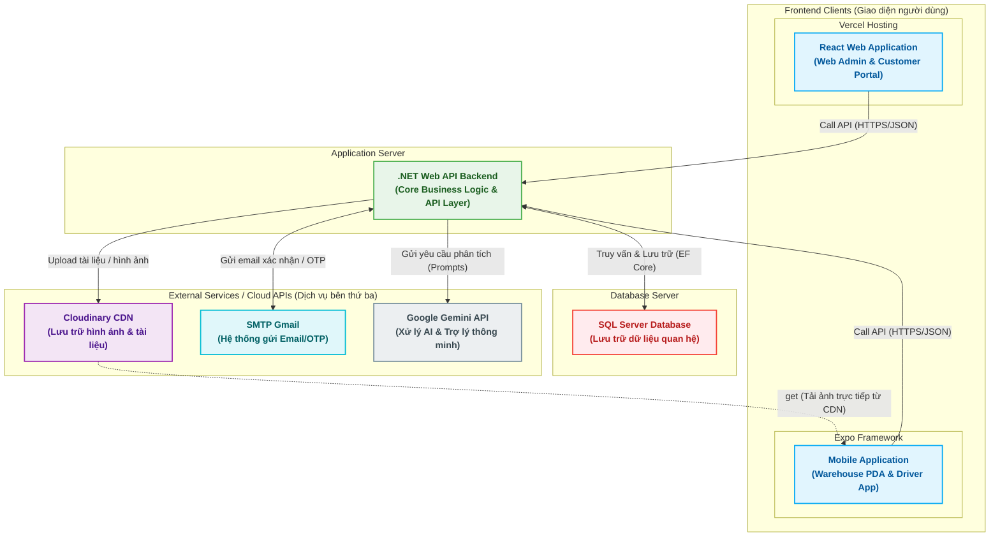

# Sơ đồ Kiến trúc Hệ thống (System Architecture Diagram)

Tài liệu này mô tả chi tiết sơ đồ kiến trúc hệ thống **Vietnam Cross-Border Logistics System (VCL)** dựa trên cấu trúc các thành phần và luồng dữ liệu thực tế giữa Frontend, Backend, Database và các Dịch vụ tích hợp bên thứ ba từ hình vẽ trên bảng của bạn.

---

## 1. Sơ đồ Kiến trúc Tổng quan (Mermaid Diagram)

Dưới đây là sơ đồ kiến trúc hệ thống được trực quan hóa bằng Mermaid.js. Sơ đồ mô tả luồng tương tác từ thiết bị đầu cuối của người dùng thông qua máy chủ ứng dụng đến cơ sở dữ liệu và các API tích hợp bên ngoài.

---

## 2. Chi tiết các thành phần trong hệ thống

### 2.1. Lớp Client (Frontend Clients)
*   **React Web Application (Web Admin & Customer Portal):**
    *   **Công nghệ & Triển khai:** Sử dụng thư viện React, được deploy lên nền tảng đám mây **Vercel** giúp tối ưu hóa tốc độ tải trang toàn cầu.
    *   **Chức năng chính:** Dành cho khách hàng (quản lý đơn ký gửi, xem báo giá, thanh toán) và nhân viên nghiệp vụ/admin (phê duyệt đơn hàng, quản trị hệ thống, giám sát vận hành).
*   **Mobile Application (Expo Framework):**
    *   **Công nghệ:** Xây dựng trên React Native bằng framework **Expo** để tối ưu hóa việc phân phối ứng dụng đa nền tảng (iOS, Android).
    *   **Chức năng chính:** Hỗ trợ nhân viên kho thực hiện các thao tác quét mã vạch (barcode/QR code), check-in kiện hàng, phân loại vị trí lưu trữ (put-away), gom hàng (consolidation) và tài xế cập nhật trạng thái vận chuyển.

### 2.2. Lớp Máy chủ Ứng dụng (Application Server - BE .NET)
*   **Công nghệ:** Xây dựng trên nền tảng **.NET 8** sử dụng kiến trúc phân tầng (Clean/N-Tier Architecture) bao gồm `VCL_API`, `VCL_BLL` và `VCL_DLL`.
*   **Chức năng chính:**
    *   Cung cấp các Restful APIs bảo mật thông qua JWT Token.
    *   Xử lý logic nghiệp vụ tính toán tải trọng/thể tích khả dụng của kho, tính toán báo giá tự động theo tuyến đường (Pricing Rules).
    *   Đảm bảo tính nhất quán dữ liệu qua Unit of Work & Repository Pattern.

### 2.3. Cơ sở dữ liệu (Database - SQL Server)
*   **Công nghệ:** Hệ quản trị cơ sở dữ liệu quan hệ **SQL Server**.
*   **Nhiệm vụ:** Lưu trữ toàn bộ thông tin nghiệp vụ bao gồm: Thông tin tài khoản, Đơn ký gửi (`Order`, `OrderItem`), Kiện hàng (`Parcel`), Thông tin kho bãi (`Warehouse`, `Bin`), Hóa đơn (`Quotation`, `Invoice`) và các Cấu hình bảng giá.

### 2.4. Dịch vụ Tích hợp Bên thứ ba (External Services)
*   **Cloudinary CDN:**
    *   **Vai trò:** Lưu trữ tệp tin tĩnh (hình ảnh thực tế kiện hàng khi check-in, ảnh hóa đơn chứng từ, chữ ký biên nhận).
    *   **Cơ chế hoạt động:** Backend .NET nhận file từ client và đẩy lên Cloudinary. Cloudinary trả về đường dẫn CDN tĩnh. Mobile App sẽ lấy trực tiếp ảnh từ Cloudinary CDN thông qua đường dẫn này để giảm tải cho Backend.
*   **SMTP Gmail:**
    *   **Vai trò:** Gửi thư điện tử xác thực tài khoản (Email OTP), thông báo thay đổi trạng thái đơn hàng hoặc gửi file báo giá tự động cho khách hàng.
*   **Google Gemini API:**
    *   **Vai trò:** Tích hợp trí tuệ nhân tạo (AI).
    *   **Ứng dụng:** Hỗ trợ quét và trích xuất thông tin tự động từ hóa đơn mua hàng (OCR), hỗ trợ tư vấn chatbot thông minh cho khách hàng, và tối ưu hóa tuyến đường vận chuyển.
